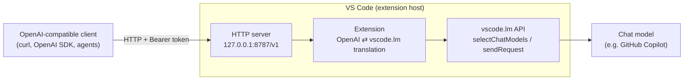

# VS Code LM OpenAI Gateway

[](https://github.com/rakshith-ponnappa/vscode-lm-openai-gateway/actions/workflows/ci.yml)
[](LICENSE)

A tiny VS Code extension that exposes the **VS Code Language Model API** (`vscode.lm`, e.g. the GitHub Copilot
chat models you already have in the editor) as a **local OpenAI-compatible API** on `http://127.0.0.1:8787/v1`.
Point any tool that speaks OpenAI Chat Completions (curl, the OpenAI SDKs, agent frameworks) at it, with tool
calling and a configurable reasoning effort. One file, no runtime dependencies.

> [!WARNING]
> **Responsible use.** This extension is intended for **personal, local development**. Requests are served by
> whichever language models VS Code makes available to you (for example GitHub Copilot), and **you are
> responsible for complying with that model provider's terms**, e.g. the GitHub Copilot product-specific terms
> and acceptable use policies, including any limits on automated or high-volume use. This project is **not
> affiliated with, endorsed by, or sponsored by GitHub or Microsoft**. **Do not expose the gateway beyond
> localhost**: no port forwarding, tunnels, reverse proxies or shared tokens.

## How it works



The extension starts on `onStartupFinished`, generates a bearer token on first run, and listens on the loopback
interface only. Each request is translated into `vscode.lm` messages, sent to the selected model, and the
model's response is collected and returned as an OpenAI `chat.completion` object.

## Features

- **`GET /v1/models`**: the chat models available through `vscode.lm` from the `copilot` vendor (id, name,
  family, `max_input_tokens`).
- **`POST /v1/chat/completions`**: OpenAI Chat Completions request/response shape. `model` matches a model
  `id` first, then a model `family`.
- **Messages**: `system`, `developer`, `user`, `assistant` (including `tool_calls`) and `tool` roles.
  Consecutive same-role messages are merged so models that need strict user/assistant alternation work, and
  parallel tool results land in one turn.
- **Tool calling**: `tools` (function tools) and `tool_choice` (`auto`, `none`, `required`, or a specific
  function). Tool calls come back as `message.tool_calls` with `finish_reason: "tool_calls"`.
- **Reasoning effort**: per request via `reasoning_effort`, otherwise the `copilotGateway.reasoningEffort`
  setting. If a model doesn't support the value, the provider ignores it and the model default applies.
- **Cancellation**: if the client disconnects, the in-flight model request is cancelled.
- **OpenAI-style errors**: `{"error": {"message", "type"}}` with 401 (bad token), 403 (model access not
  granted), 404 (unknown model/route), 413 (body too large), 429 (provider quota/rate limit), 502 (other
  model errors).
- **Content-free logs**: the *Copilot LM Gateway* output channel logs method, path, status, model and latency.
  Prompts and completions are never logged.

## Security design

| Control | Implementation |
|---|---|
| Bearer token | 32 random bytes (`crypto.randomBytes`, hex), generated on first activation and reused afterwards. Every route, including `/v1/models`, requires `Authorization: Bearer <token>`. |
| Constant-time comparison | The presented token is compared with `crypto.timingSafeEqual` (after a length check). |
| Token file permissions | `~/.copilot-lm-gateway/token` is written with mode `0600` inside a directory created with mode `0700`. Modes are applied when the file/directory is created; existing ones are left as they are. |
| Loopback only | The server binds to `127.0.0.1` and is unreachable from other machines. |
| Body limit | Request bodies over **20 MB** are rejected with `413` and the socket is closed. |
| No CORS | No CORS headers are sent, so web pages in your browser can't call the gateway. |
| Consent | VS Code asks you to allow the extension to use language models (run the *Test* command once). |

The trust boundary is your OS user account: any local process that can read the token file can use the gateway.
To rotate the token, delete `~/.copilot-lm-gateway/token` and reload the VS Code window.

## Install

Requirements: VS Code **1.95+**, and a signed-in language model provider that exposes chat models through
`vscode.lm` (for example the GitHub Copilot Chat extension).

```bash
git clone https://github.com/rakshith-ponnappa/vscode-lm-openai-gateway.git
cd vscode-lm-openai-gateway
npx @vscode/vsce package --no-dependencies          # -> vscode-lm-openai-gateway-0.2.0.vsix
code --install-extension vscode-lm-openai-gateway-0.2.0.vsix
```

Each CI run also uploads the packaged `.vsix` as a build artifact.

After installing:

1. Reload VS Code. The *Copilot LM Gateway* output channel should show
   `Listening on http://127.0.0.1:8787/v1 (token file: ...)`.
2. Run **Copilot LM Gateway: Test (grant model access)** from the Command Palette and click **Allow** when VS
   Code asks whether the extension may use language models. Without this, requests fail with `403`.

## Usage

### curl

```bash
TOKEN="$(cat ~/.copilot-lm-gateway/token)"

# List models and pick an id
curl -s -H "Authorization: Bearer $TOKEN" http://127.0.0.1:8787/v1/models

curl -s http://127.0.0.1:8787/v1/chat/completions \
  -H "Authorization: Bearer $TOKEN" \
  -H "Content-Type: application/json" \
  -d '{
        "model": "<model-id>",
        "messages": [
          {"role": "system", "content": "Answer in one sentence."},
          {"role": "user", "content": "What does a reverse proxy do?"}
        ]
      }'
```

### OpenAI Python SDK

```python
from pathlib import Path

from openai import OpenAI

client = OpenAI(
    base_url="http://127.0.0.1:8787/v1",
    api_key=(Path.home() / ".copilot-lm-gateway" / "token").read_text().strip(),
)

print([m.id for m in client.models.list()])

resp = client.chat.completions.create(
    model="<model-id>",  # an id from the list above
    messages=[{"role": "user", "content": "Write a haiku about localhost."}],
    reasoning_effort="low",  # optional; overrides the copilotGateway.reasoningEffort setting
)
print(resp.choices[0].message.content)

# Tool calling
tools = [{
    "type": "function",
    "function": {
        "name": "get_time",
        "description": "Current time in a timezone",
        "parameters": {"type": "object", "properties": {"tz": {"type": "string"}}, "required": ["tz"]},
    },
}]
resp = client.chat.completions.create(
    model="<model-id>",
    messages=[{"role": "user", "content": "What time is it in Tokyo?"}],
    tools=tools,
    tool_choice="required",
)
print(resp.choices[0].message.tool_calls)
```

### Pointing other OpenAI-compatible clients at the gateway

Most clients only need a base URL and an API key:

```bash
export OPENAI_BASE_URL="http://127.0.0.1:8787/v1"
export OPENAI_API_KEY="$(cat ~/.copilot-lm-gateway/token)"
```

[`examples/`](examples) shows this for [TradingAgents](https://github.com/TauricResearch/TradingAgents):
`ta-env.sh` exports the base URL, the token and the model ids, and `run-tradingagents.sh` runs the CLI with that
environment. Configuration comes from environment variables and placeholders; nothing is hard-coded.

```bash
TA_DIR=/path/to/TradingAgents QUICK_MODEL=<model-id> DEEP_MODEL=<model-id> ./examples/run-tradingagents.sh
```

The `TRADINGAGENTS_*` variable names match the TradingAgents build the script was written for. Check your
version's configuration and adjust them if needed.

## Settings

| Setting | Type | Default | Description |
|---|---|---|---|
| `copilotGateway.port` | number | `8787` | Port on 127.0.0.1 for the OpenAI-compatible endpoint. Read at startup, so reload the window after changing it. |
| `copilotGateway.reasoningEffort` | string | `"xhigh"` | Reasoning effort sent with every request (e.g. `low`, `medium`, `high`, `xhigh`). An empty value uses the model picker setting. A request's `reasoning_effort` takes precedence. |

Command: **Copilot LM Gateway: Test (grant model access)** (`copilotGateway.test`) sends a one-word prompt to
the first available model, lists the model ids in the output channel, and triggers VS Code's model-access consent.

> The extension's internal names (`copilotGateway.*` settings, output channel, command title, and the
> `~/.copilot-lm-gateway` token directory) are kept from the original project for compatibility.

## Limitations

- **No streaming.** `stream: true` is rejected with `400`. The model's output is collected and returned in a
  single response.
- **Text only.** Image/audio content parts are dropped. Only text parts are forwarded.
- **Sampling parameters are ignored**: `temperature`, `top_p`, `max_tokens`, `stop`, `n`, `response_format`,
  `seed`, and similar fields aren't passed to the model.
- **`usage` is always zero**: token counts aren't reported.
- **Copilot vendor only**: models are selected with `vendor: 'copilot'`.
- **System prompts become user messages**, because the stable `vscode.lm` API has no system role.
- Only `/v1/models` and `/v1/chat/completions` are implemented (no embeddings, legacy completions or Responses API).
- VS Code must be running. With several windows open, the first window to start owns the port and the others log
  a harmless "could not listen" error.
- The provider's quotas and rate limits still apply (surfaced as `429`).

## Roadmap

- [ ] Server-sent events for `stream: true`
- [ ] Token usage via `LanguageModelChat.countTokens`
- [ ] Configurable vendor filter (models from other `vscode.lm` providers)
- [ ] Image input parts
- [ ] Commands to copy/rotate the token and a status bar indicator
- [ ] Integration tests with `@vscode/test-electron`

## Development

```bash
node --check extension.js                          # syntax check (also run in CI)
npx @vscode/vsce package --no-dependencies         # build the .vsix
```

To debug, open the folder in VS Code, press <kbd>F5</kbd> and choose **VS Code Extension Development** to start
an Extension Development Host with the extension loaded.

## License

[MIT](LICENSE)
